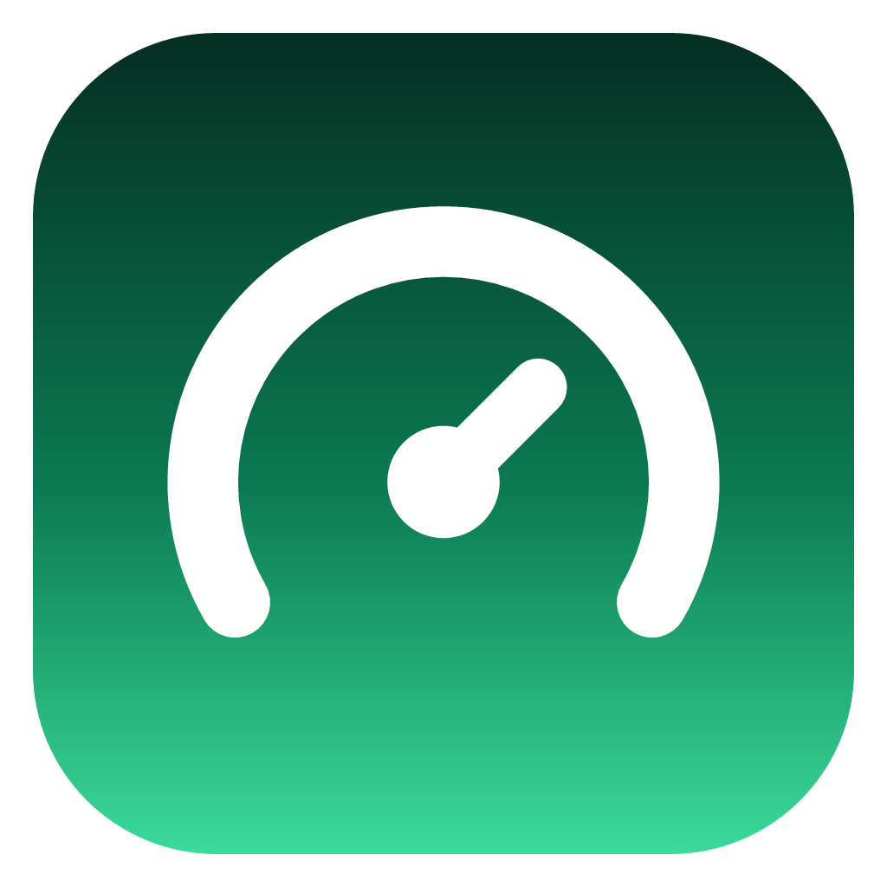
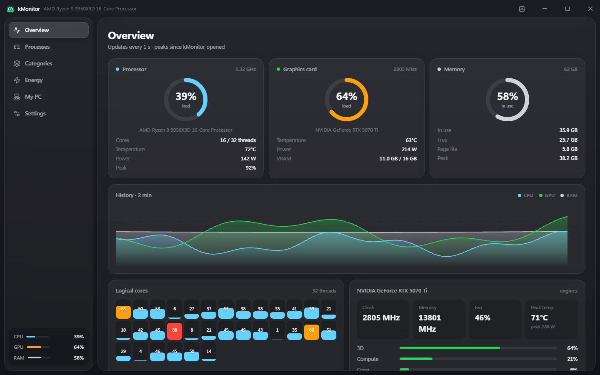
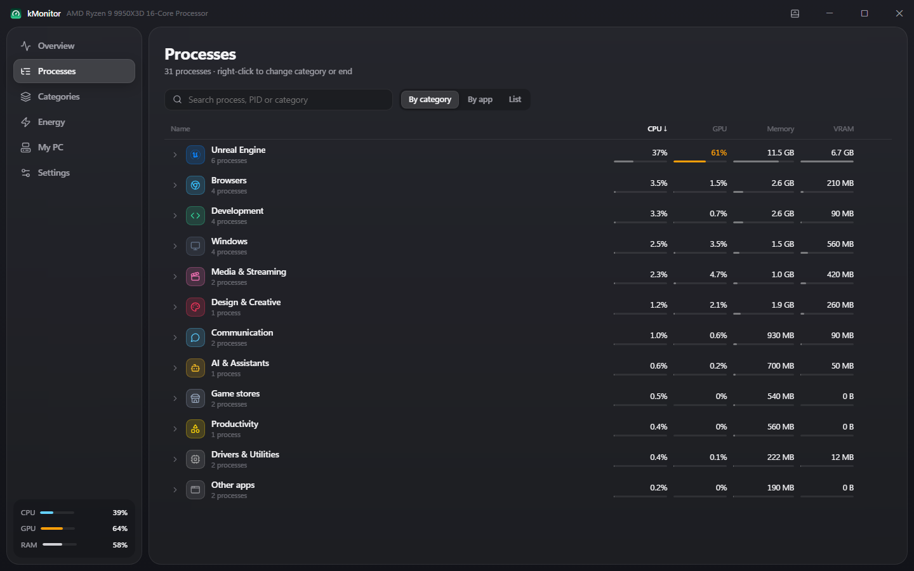
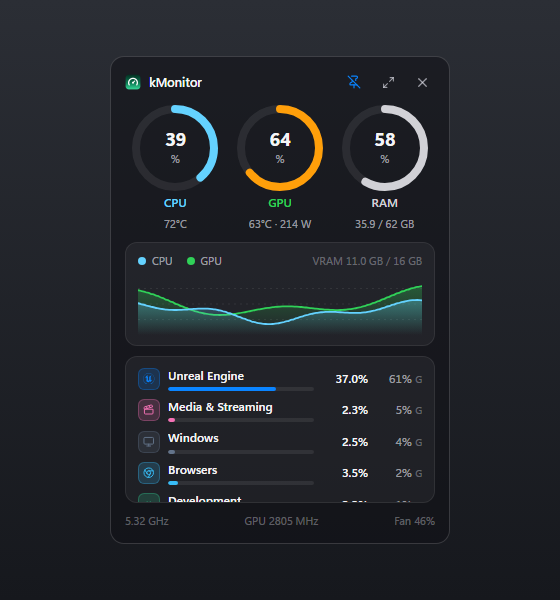
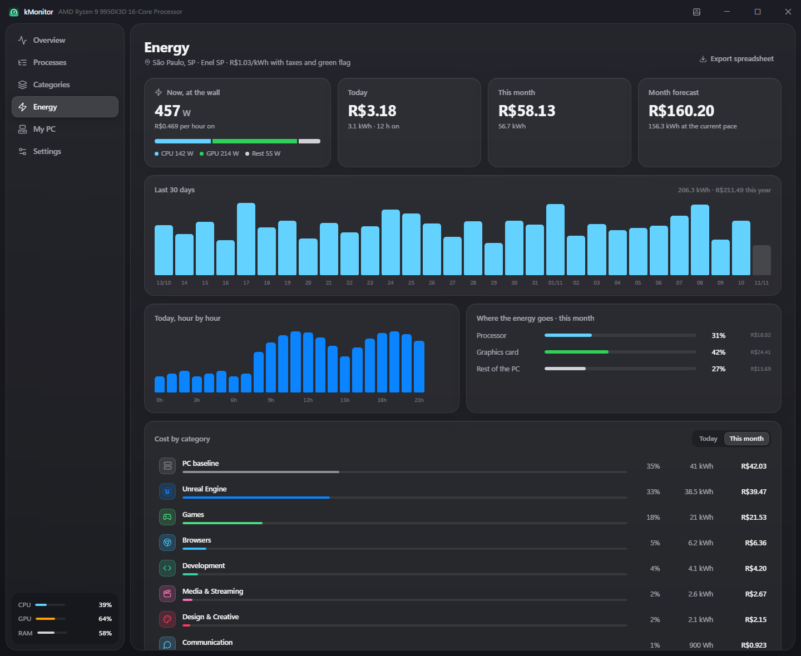
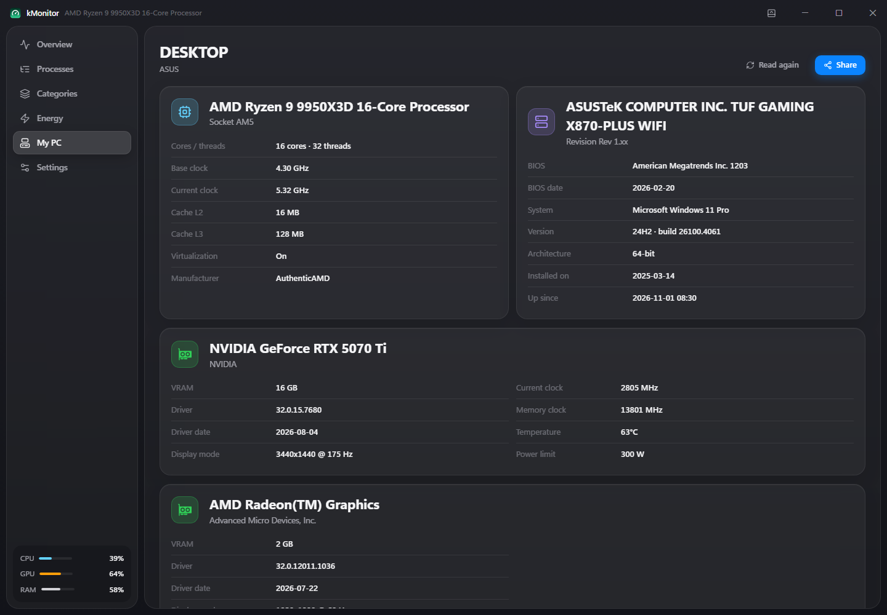
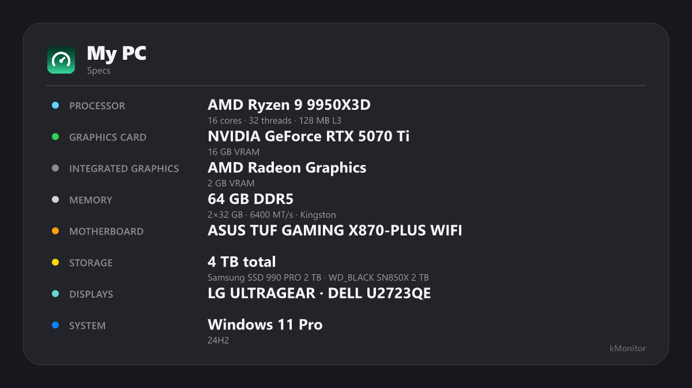
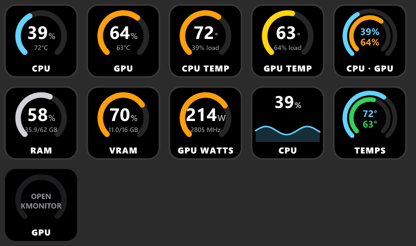

<p align="center">
  
</p>

<h1 align="center">kMonitor</h1>

<p align="center">
  <b>A light, good-looking system monitor for Windows: CPU, GPU, memory and the apps behind them.</b><br>
  Processes are grouped by what they belong to, so all of Unreal Engine shows up as one line with its total.<br>
  Lives in the tray, has a mini monitor one click away, and tracks what your PC costs in electricity.
</p>

<p align="center">
  
  
  
  
  
</p>

<p align="center">
  <a href="#features"><b>Features</b></a> ·
  <a href="#how-it-works">How it works</a> ·
  <a href="#get-started">Get started</a> ·
  <a href="#cpu-temperature-and-power">CPU temperature</a> ·
  <a href="#energy-cost">Energy cost</a> ·
  <a href="#stream-deck">Stream Deck</a> ·
  <a href="README.pt-BR.md">Português</a>
</p>

<p align="center">
  
  <br>
  <sub>Overview: load, temperatures, clocks and power at a glance, with a two-minute history.</sub>
</p>

<table>
  <tr>
    <td width="25%" valign="top">
      <h3>🧩 Grouped by app</h3>
      Unreal Editor, its shader compilers and its helpers count as one Unreal Engine line. Same for browsers, games, dev tools and more, and you choose the rules.
    </td>
    <td width="25%" valign="top">
      <h3>🪶 Light</h3>
      A Rust core and a native WebView, about 4 MB installed. With every window closed it reads only the totals, every 2 seconds.
    </td>
    <td width="25%" valign="top">
      <h3>🌡️ Real sensors</h3>
      GPU usage per process like Task Manager, NVIDIA temperature, power and clocks, and Ryzen CPU temperature and power through the signed PawnIO driver.
    </td>
    <td width="25%" valign="top">
      <h3>⚡ What it costs</h3>
      Logs your PC's energy hour by hour and turns it into money with your local tariff, split by category.
    </td>
  </tr>
</table>

### 🌍 3 languages

Português (Brasil), English and Español. kMonitor follows the Windows language, or the one you pick in Settings. The tray menu, the installer and the Stream Deck plugin follow along.

To add a language, add a dictionary to [`src/locales.ts`](src/locales.ts) keyed by the Portuguese text, and list it in [`src/i18n.ts`](src/i18n.ts).

## Features

<table>
  <tr>
    <td width="50%" valign="top">
      
      <br>
      <sub>Processes grouped by category, with totals per group.</sub>
      <h3>Heavy processes, grouped</h3>
      See processes by category, by app or as a flat list, sorted by CPU, GPU, memory or VRAM. Expand a category to see its apps, and an app to see each process.
      <br><br>
      Right-click to move an app to another category, open its file location or end it. Helpers like a launcher's WebView inherit the category of whoever started them.
    </td>
    <td width="50%" valign="top">
      
      <br>
      <sub>The mini monitor, opened from the tray icon.</sub>
      <h3>Tray and mini monitor</h3>
      The tray icon shows CPU and GPU as live bars, or either one as a number. Click it for the mini monitor; double-click for the full app.
      <br><br>
      Pin the mini monitor and it becomes a floating widget you can drag anywhere. Closing the main window keeps kMonitor in the tray.
    </td>
  </tr>
  <tr>
    <td width="50%" valign="top">
      
      <br>
      <sub>Energy: power at the wall, cost per day, hour and category.</sub>
      <h3>Energy and cost</h3>
      Power right now at the wall, today's and this month's cost, a month forecast, the last 30 days and today hour by hour. The cost is split between categories, so you see what Unreal or your games cost this month.
      <br><br>
      Export everything to spreadsheets (per day, per hour, per category) with one click.
    </td>
    <td width="50%" valign="top">
      
      <br>
      <sub>My PC: the whole hardware inventory.</sub>
      <h3>My PC, and a card to share</h3>
      Processor, motherboard and BIOS, each graphics card, every memory stick, disks and free space, displays, network and Windows version.
      <br><br>
      <b>Share</b> copies the specs as text or as an image card, without the PC name, network or serial numbers.
    </td>
  </tr>
</table>

<p align="center">
  
  <br>
  <sub>The shareable specs card.</sub>
</p>

## How it works

```
 ┌───────────────────────────── kMonitor (Rust) ─────────────────────────────┐
 │  sampler thread, once per second (every 2 s in the tray)                  │
 │   ├─ sysinfo ............ CPU per core, memory, processes                 │
 │   ├─ PDH counters ....... GPU usage and VRAM per process (like Task Mgr)  │
 │   ├─ DXGI + NVML ........ graphics cards, temperature, power, clocks, fan │
 │   ├─ PawnIO (optional) .. Ryzen Tctl, per-CCD temperatures, RAPL power    │
 │   └─ categories ......... name / path rules, helpers inherit their parent │
 │                                                                           │
 │  energy.json ◀─ Wh per hour, per day and per category                     │
 │  tray icon   ◀─ live bars          windows ◀─ events ─▶ React UI          │
 │  127.0.0.1:47615 ─▶ Stream Deck plugin                                    │
 └───────────────────────────────────────────────────────────────────────────┘
```

Everything stays on your PC. The only network listener is the local API for the Stream Deck plugin, bound to `127.0.0.1`.

## Get started

**Install:** run `kMonitor_0.1.0_x64-setup.exe` (build it as below). It installs to `Program Files` (Windows asks for administrator once) and offers to install PawnIO at the end (see below).

**Build from source** on Windows 10 or 11 with [Rust](https://rustup.rs/), [Node.js](https://nodejs.org/) 20 or newer and the WebView2 runtime (built into Windows 11):

```bash
git clone https://github.com/Kromaverso/k-monitor.git
cd k-monitor
npm install
npm run tauri dev      # run the app
npm run tauri build    # build the installer into src-tauri/target/release/bundle/nsis
```

`npm run tauri build` downloads the official PawnIO installer on the first build and checks its SHA-256 before bundling it.

The glass backdrop needs Windows 11. On Windows 10 the app works the same, without the blur.

## CPU temperature and power

Windows doesn't give the temperature or power of Ryzen processors to regular programs: reading them needs a kernel driver. kMonitor uses [PawnIO](https://pawnio.eu), a free, open-source and signed driver (the same one LibreHardwareMonitor uses), with its official `AMDFamily17` module.

1. Install PawnIO, either from the kMonitor installer or from pawnio.eu.
2. In **Settings → CPU sensors**, click **Turn on** and confirm the Windows prompt.

kMonitor then registers a scheduled task that starts it as administrator at logon, so Windows doesn't ask again. Opening kMonitor normally hands over to that task. **Turn off** removes it, and so does uninstalling.

The task only ever starts a kMonitor under `Program Files`, which only administrators can change. A copy anywhere else could be swapped by any program running as you, so kMonitor refuses to turn on admin mode from there.

Supported: AMD Ryzen, Zen 1 to Zen 5. Everything else in kMonitor works without PawnIO.

## Energy cost

- **What's measured:** the GPU (NVIDIA driver) and, with PawnIO, the CPU package (RAPL).
- **What's estimated:** the CPU without PawnIO, and the rest of the PC (motherboard, memory, disks, fans) as a fixed wattage. Everything is converted to power at the wall with your PSU efficiency, plus your displays if you add them.
- **By category:** CPU energy goes to categories by their share of CPU load, GPU energy by their share of GPU load. What no app uses (idle, motherboard, displays) is the **PC baseline**.
- **Tariff:** comes set for São Paulo (Enel SP, B1 residential, ANEEL REH 3.596/2026) with the monthly tariff flag and taxes, and every value is editable.
- **Storage:** `%APPDATA%\com.kromaverso.kmonitor\energy.json`, every hour kept (about 1 MB a year). **Export spreadsheet** writes three CSVs to `Documents\kMonitor`.

## Stream Deck

<p align="center">
  
</p>

The plugin in [`streamdeck/`](streamdeck) shows live gauges on your keys: CPU or GPU load and temperature, both at once in two rings, RAM, VRAM, GPU power or the whole PC's power, as a gauge or a 40-second graph. Pressing a key opens kMonitor or the mini monitor. It reads kMonitor's local API, so kMonitor must be running (the tray is enough).

```bash
cd streamdeck
npm install
npm run build          # creates release/kMonitor.streamDeckPlugin; double-click it to install
```

## Under the hood

| Endpoint (127.0.0.1:47615) | What it does |
|---|---|
| `GET /v1/stats` | CPU, GPU, memory, power and a short history, as JSON |
| `GET /v1/open` | Shows the main window |
| `GET /v1/mini` | Toggles the mini monitor |

```
src/                     React UI (main window and mini monitor)
├── pages/               Overview, Processes, Categories, Energy, My PC, Settings
├── i18n.ts, locales.ts  translations
├── share.ts             shareable specs text and image card
└── capture.ts           sample data for the README screenshots
src-tauri/src/
├── monitor.rs           the sampler
├── gpu.rs               PDH, DXGI and NVML
├── cputemp.rs           PawnIO: Tctl, CCD temperatures, RAPL
├── categories.rs        default categories and matching
├── energy.rs            energy log, split and CSV export
├── elevate.rs           admin mode through a scheduled task
├── server.rs            local API for the Stream Deck
├── shell.rs, tray.rs    windows, tray menu and live tray icon
└── specs.rs             hardware inventory (WMI)
streamdeck/              Stream Deck plugin
tools/capture.mjs        renders the screenshots in docs/images
tools/share-card.mjs     renders the shareable card example
tools/render-icons.mjs   renders assets/icon.png and heart-icon.png from the SVGs
```

To refresh the screenshots, run `npx vite` and then `node tools/capture.mjs en` and `node tools/share-card.mjs en`. The pages run on sample data in the browser, not on your PC's.

## Privacy

- Nothing leaves your PC. There's no account, telemetry or update check.
- The local API answers only on `127.0.0.1` and only to local programs: it refuses any request from a web browser and any `Host` other than this PC, so websites can't read it or open kMonitor's windows. It can be turned off in Settings.
- Admin mode runs only the copy in `Program Files` (see [CPU temperature](#cpu-temperature-and-power)).
- The shareable card leaves out the PC name, network and serial numbers.

---

<p align="center">
  <sub>Made by <a href="https://github.com/Kromaverso">Kromaverso</a>. CPU sensors by <a href="https://pawnio.eu">PawnIO</a> (namazso). Stream Deck is a trademark of Elgato (Corsair); kMonitor is not affiliated with Elgato.</sub>
</p>
