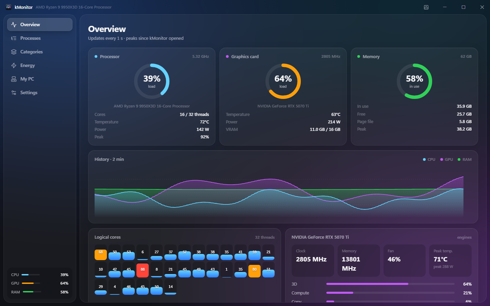

<p align="center">
  
</p>

<h1 align="center">kMonitor</h1>

<p align="center">
  <b>Monitor de sistema leve e bonito para Windows: CPU, GPU, memória e os apps por trás delas.</b><br>
  Os processos ficam agrupados pelo que são: todo o Unreal Engine aparece numa linha só, com o total.<br>
  Fica na bandeja, tem um mini monitor a um clique e mostra quanto o PC gasta de energia.
</p>

<p align="center">
  <a href="README.md">English</a>
</p>

<p align="center">
  
</p>

## O que ele faz

- **Processos agrupados por categoria:** Unreal Engine, navegadores, jogos, desenvolvimento, design e mais, com o total de CPU, GPU, memória e VRAM de cada grupo. As regras são editáveis, e dá para mover um app de categoria com o botão direito.
- **Bandeja e mini monitor:** o ícone da bandeja mostra CPU e GPU ao vivo. Um clique abre o mini monitor, que pode ser fixado na tela como widget.
- **Sensores de verdade:** uso de GPU por processo (como o Gerenciador de Tarefas), temperatura, consumo e clocks da NVIDIA, e temperatura e consumo do Ryzen pelo driver assinado PawnIO.
- **Consumo e custo:** registra a energia do PC hora a hora e calcula o custo com a tarifa da sua distribuidora (vem com a da Enel SP), dividido por categoria. Exporta para planilha.
- **Meu PC:** todo o hardware, com um botão para compartilhar as specs como texto ou imagem, sem nome do PC, rede ou números de série.
- **Stream Deck:** plugin com gauges de uso, temperatura e consumo nas teclas.
- **3 idiomas:** português, inglês e espanhol, seguindo o idioma do Windows ou o escolhido em Ajustes.

## Como rodar

Windows 10 ou 11 com [Rust](https://rustup.rs/), [Node.js](https://nodejs.org/) 20+ e o WebView2 (já vem no Windows 11):

```bash
git clone https://github.com/Kromaverso/k-monitor.git
cd k-monitor
npm install
npm run tauri dev      # roda o app
npm run tauri build    # gera o instalador em src-tauri/target/release/bundle/nsis
```

## Temperatura da CPU

O Windows não entrega a temperatura nem o consumo de processadores Ryzen a programas comuns. O kMonitor usa o [PawnIO](https://pawnio.eu), um driver gratuito, open source e assinado (o mesmo do LibreHardwareMonitor). O instalador do kMonitor oferece instalá-lo. Depois, em **Ajustes → Sensores da CPU → Ativar**, o Windows pede permissão uma vez e o kMonitor passa a iniciar como administrador por uma tarefa agendada.

## Onde ficam os dados

Tudo fica no seu PC, em `%APPDATA%\com.kromaverso.kmonitor`: configurações, categorias, specs e o histórico de energia (`energy.json`, hora a hora, cerca de 1 MB por ano). Nada é enviado para a internet.

Os detalhes técnicos (como a energia é dividida, a API local, a estrutura do código) estão no [README em inglês](README.md).

---

<p align="center">
  <sub>Feito pela <a href="https://github.com/Kromaverso">Kromaverso</a>.</sub>
</p>
